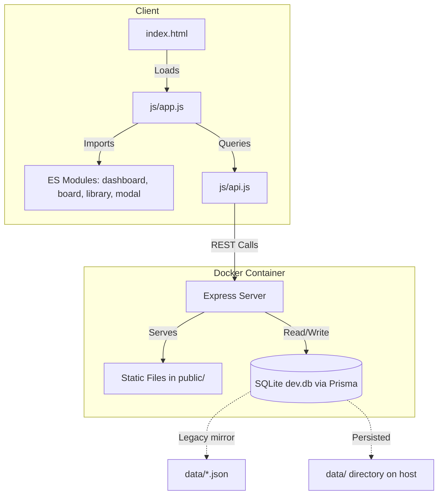

# Architecture & Stack Overview

The **repo-ops-tracker** uses a lightweight, low-overhead stack designed for local personal use. It eliminates runtime compilation dependencies and build pipelines, maintaining high execution speed and simplicity.

## Architecture Diagram

## Stack Components

### 1. Frontend (Zero-Build ESM)
Instead of bundling packages using tools like Webpack, Vite, or Rollup, the browser serves native **ES Modules (ESM)**. 
- In [[Index]], `<script type="module" src="js/app.js">` bootstraps the system.
- Modules are loaded asynchronously, making code organization modular without compile overhead.

### 2. Backend (Node.js & Express)
- Exposes a REST API backed by a Prisma/SQLite persistence layer (legacy JSON files are mirrors only).
- Serves the `public/` folder statically.
- Keeps dependencies minimal: `express` at runtime plus `@prisma/client`, with `prisma` as a dev dependency.

### 3. State & Persistence
- Eliminates browser-only `localStorage` for system resilience.
- Persists all state in a SQLite database (`data/dev.db`) via Prisma, which is the source of truth.
- On boot, the DB layer runs `prisma migrate deploy` and derives `DATABASE_URL` from `DATA_DIR` (default `./data`, or `/app/data` in Docker).
- Legacy JSON files under `data/` are written as mirrors for backward compatibility only and may lag the database.
- Mounted volume in [[Docker & Persistence]] links the database file to the host disk.
